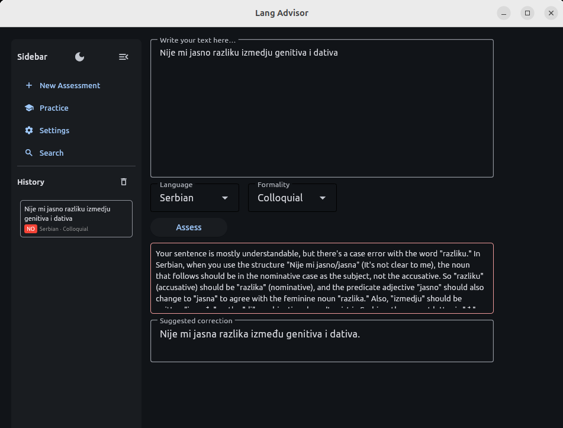
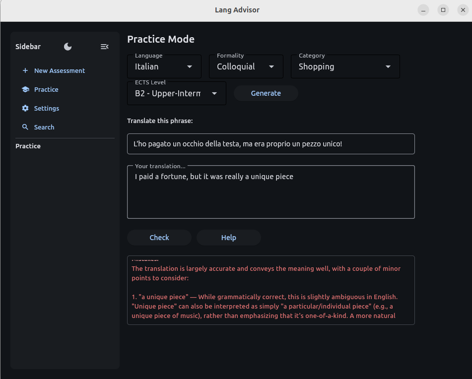
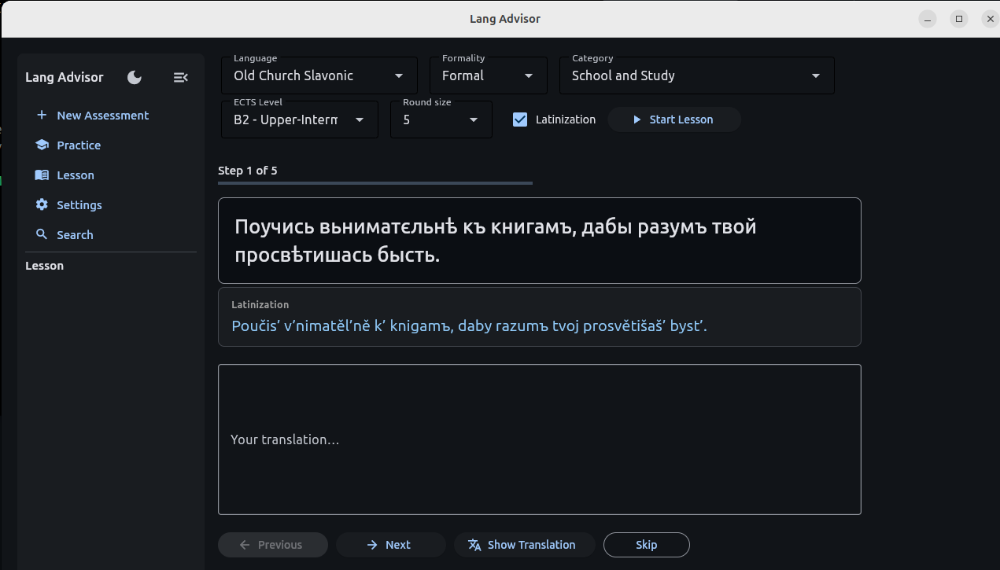
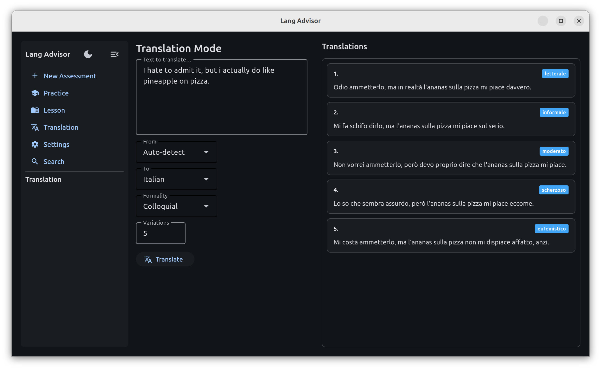
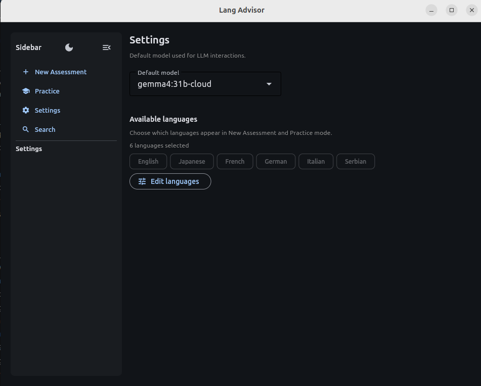

# LangAdvisor


> [!NOTE]  
> This repository has been archived and rewritten as a native golang-based webapp at https://github.com/atomic77/langadvisor-go . 

A desktop GUI or web application providing a fun toolkit for polyglots out there, including grammar assessment, practice and translation. Leverages local LLMs via [Ollama](https://docs.ollama.com/) for enhanced privacy, or cloud
LLMs via [Ollama Cloud](https://docs.ollama.com/cloud) service. See the Models section below for details on what available models work best. 


## Features

Self-conscious about mistakes you might be making in messages or emails? You can quickly submit your message for an assessment of its correctness and intelligibility by a native speaker:



Want some interactive practice, suited to your level and a topic of interest? You can generate phrases and have your translations graded:



A lesson mode can be used to queue up a series of phrases that are graded at the end, with help provided along the way as needed.


A translation mode enables you to get a variety of different potential translations for phrases:



Virtually any major language is supported, including ancient languages, and you can decide which Ollama model you wish to use depending on your desire for local execution, speed or accuracy. Latinization is supported for non-Western languages, where such a standard exists. More obscure languages may require a more powerful model to get decent results:



## Prerequisites

- Python 3.10+
- [uv](https://docs.astral.sh/uv/getting-started/installation/) 
- [Ollama](https://ollama.com/) 

## Models

Cloud or local models should both work without issue, depending on whether you want to run with your own hardware or a Ollama
Cloud account.

### Free Tier

Within the free tier:

* [gemma4-31b](https://ollama.com/library/gemma4) is the best combination of accuracy and speed
* [nemotron-super](https://ollama.com/library/nemotron-3-super) and ultra may provide better results, but appear to run quite a bit slower on Ollama Cloud
* [gpt-oss:120b](https://ollama.com/library/gpt-oss:120b) is also a viable alternative


### Paid Tier

For better results, particularly with less common languages, paid tier models are available. Ollama recently added a "Usage credits" feature that functions as pay-as-you-go, allowing you to add as little as $5 to your account. This makes mid-tier models affordable for everyday use, without committing to a $20+ monthly subscription.

A convenient price list is [available here](https://allaimodel.com/providers/ollama-cloud) for the models currently available. 

[minimax-m3](https://ollama.com/library/minimax-m3) and [GLM-5.3-Flash](https://ollama.com/library/glm-5.3-flash) provide good value and performance.


## Running

You can download pre-built desktop apps for Windows and Linux in the Releases pane if you don't want to clone the source.

It's also quite easy to run from source if you have `uv` installed. Simply clone the source code and run: 

   
```bash
   uv run main.py
```

`uv` will automatically create a local virtual environment and pull down needed dependencies.

### As a webserver

If you have a server where you'd like to host the app for multiple users to access over the web, it's as simple as:

```bash
FLET_FORCE_WEB_SERVER=true FLET_SERVER_PORT=8008 uv run main.py
```

Then the app will be available on http://myserver:8008/ . Ensure you have ollama running wherever you are running this from.
A raspberry pi or equivalent works well if you are routing requests to Ollama Cloud and want to make this available to devices
in your local network.
